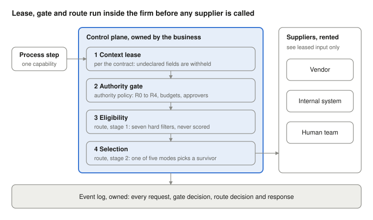

# Keep the Process, Change the Supplier: An Open Process Control Plane for Supplier-Portable AI Operations

**Deepak Waghmare** (Two Much Labs) and **Shaad Sufi** (Wubble.ai)

Draft v0.1, 19 November 2026. Not yet submitted or peer reviewed. Describes OPCP package version 0.3.2. Items marked **\[TO RUN\]** describe evaluation that has not been done; no result is reported for them. Comments are welcome as issues on this repository.

## Abstract

Enterprises increasingly run business processes inside vendor platforms and vendor AI agents. When one supplier holds a firm's process logic, its accumulated context and the authority to act, replacing that supplier means rebuilding part of the business. Financial supervisors in several jurisdictions now expect regulated firms to hold exit plans they can execute, yet most exit plans are documents that have never been tested.

We present the **Open Process Control Plane (OPCP)**, an open specification and reference runtime that keeps three things with the business and treats everything else as replaceable: process logic, held as owned and versioned specifications; context, held in the firm's own event log and lent to suppliers one call at a time; and authority, exercised through a single gate that every action passes. Suppliers, internal systems and human teams plug in underneath through capability contracts drawn from seven interaction archetypes and one call envelope. Routing separates hard eligibility rules from scored selection, and the authority gate applies Reversibility Classes R0 to R4 \[1\].

OPCP makes two further contributions. An **Exit-Readiness Scorecard** rates each critical process by its weakest of seven measures and records the evidence level behind every answer. A **supplier swap drill** turns an estimated time-to-swap into a proven one: a candidate supplier runs in shadow against business-owned regression cases, and promotion requires six gates that are never averaged or traded off.

We release the specification, seven JSON Schemas, a Python reference runtime (version 0.3.2, 332 tests) and 58 language-neutral conformance fixtures under Apache 2.0. We also report two rounds of adversarial review that produced 30 findings, two of them critical: failover after a lost supplier reply executed a ledger posting twice, and the swap-drill evaluator passed a drill whose authority policy had changed. We describe what each finding changed in the runtime and the specification, state what remains open, and set out the evaluation still required, including an independent implementation and a drill at a regulated firm.

## 1 Introduction

Consider a bank that verifies customer identity through a vendor's AI agent. The vendor's platform holds the verification steps, the thresholds and the exception rules. Three years of reviewer corrections sit in the vendor's data store. The agent decides what it may do under the vendor's permission model. The bank can cancel the contract, but it cannot take the process with it.

This is the dependency that supervisors now ask firms to manage. The usual answers address one layer each. A model gateway makes the model replaceable, but not the process built around it. A tool protocol such as MCP \[13\] standardises how an agent reaches a tool, but leaves the question of who may act, and on whose data, to each product. A workflow engine holds the process, but treats each supplier as a bespoke integration. None gives the firm a way to show that a supplier can be replaced before it has to be.

OPCP starts from a division of ownership. The business owns the nouns: what its processes are, what it knows, and who may act. Suppliers provide the verbs. A process step calls a *capability*, never a vendor, and the control plane decides at call time which supplier fulfils it, whether the action is within authority, and which fields of the firm's data the supplier may see.

We make five contributions:

- **A small contract model.** Seven archetypes (`check`, `extract`, `generate`, `transact`, `retrieve`, `notify`, `human_task`) and one envelope describe every capability call, with humans and outsourcers treated as suppliers like any other (Section 4).
- **Routing that cannot trade away a hard rule.** Seven eligibility filters run before any scoring, and an authority gate using Reversibility Classes R0 to R4 \[1\] runs before any supplier is invoked (Section 4).
- **A context lease.** A supplier receives only the fields the contract declares, at every depth, and the lease fails closed (Section 4).
- **Exit as a tested property.** A scorecard with evidence levels, and a swap drill whose six gates make time-to-swap *proven* (Section 5).
- **An adversarial account of the design.** Two review rounds, 30 findings, the fixes, and the conformance fixtures that now pin each rule (Sections 6 and 7).

The specification, schemas, fixtures and reference runtime are available under Apache 2.0 at [github.com/TwoMuchLabs/opcp](https://github.com/TwoMuchLabs/opcp) and on PyPI as `opcp`. This paper describes package version 0.3.2 (16 November 2026). OPCP has no production deployment and no external reviewer yet; Section 9 states what follows from that.

## 2 Background and motivation

**Supervisors expect exits that work.** The EU Digital Operational Resilience Act requires financial entities to hold exit strategies for ICT services that support critical or important functions (Art. 28(8)) \[2\], and European supervisors designated the first critical ICT third-party providers in November 2025 \[5\]. APRA's CPS 230 commenced on 1 July 2025 \[3\]. The Monetary Authority of Singapore consulted in March 2026 on Guidelines on Third-Party Risk Management that would replace its outsourcing guidelines \[4\]. The Basel Committee's December 2025 principles expect banks to prepare for leaving a provider both by choice and in a crisis, using realistic scenarios \[6\].

**Substitution is the weak point.** ECB Banking Supervision reported in February 2025 that the share of outsourced critical functions that are difficult or impossible to substitute rose from 80% to 82% \[8\]. The European Supervisory Authorities found that 29% of the 3,383 major ICT incidents reported by EU financial entities in 2025 were caused by a failure attributable to a third-party provider \[9\]. The Financial Stability Board lists third-party dependencies and service-provider concentration first among the AI-related vulnerabilities that could increase systemic risk \[7\].

**Switching costs are real and old.** Farrell and Klemperer show that switching costs give suppliers market power over locked-in customers \[11\]. Peukert estimates average IT-outsourcing switching costs at about one-third of annual professional-services spend across 1,318 US credit unions \[10\]. AI adds a new cost: prompts engineered for one model often perform substantially worse on another \[12\], so the process logic embedded around a model does not move for free.

**Agents concentrate three things at once.** A traditional outsourced service held data and ran a function. An agentic platform also holds the process logic, as prompts, tool wiring and exception rules, and the authority to act, as its own permission model. The firm's ability to leave then depends on three questions that existing third-party registers do not ask separately: where the rules live, whether learned context can leave in usable form, and whose permission model governs actions. OPCP's scorecard measures each (Section 5), and its runtime is one way to answer all three in the firm's favour.

Nothing in this paper is legal or regulatory advice. We cite obligations to show relevance, not to claim that using OPCP satisfies them.

## 3 Design goals and non-goals

Six principles shape the specification:

1. **Own the nouns, rent the verbs.** The business owns process definitions, context and authority. Suppliers provide actions.
2. **Contracts before suppliers.** A process calls a capability, never a vendor.
3. **Exit is a feature.** Every critical capability has a named fallback and a measured time-to-swap.
4. **Context leaves on lease and comes home.**
5. **Every action is reversible or explicitly approved.**
6. **Open formats in the owned layers.** Nothing the business owns is stored in a format only one product can read.

A seventh goal applies to the project itself: OPCP must not become the next concentration risk. Everything, including the specification, is under Apache 2.0 with its patent grant. There is no contributor licence agreement, so no single party can relicense the project. The specification is separate from the implementation, with public conformance fixtures, and normative changes stay open for at least 14 days.

OPCP is deliberately narrow. It is not a workflow engine: it governs one capability call at a time, and sequencing belongs to whatever runs the process. It is not a transport: an adapter may call a REST API, a queue, an MCP server or a person's work queue. It is not identity management: the `principal` on a request is taken as given. It is not a policy language: the gate applies a fixed decision per Reversibility Class plus budgets, approvers and overrides, and never consults a model. It is not a certification: the scorecard is a self-assessment against a published method.

## 4 The OPCP model

A business process is a sequence of steps, and each step calls exactly one capability. The control plane sits between the step and whoever fulfils it. Figure 1 shows the parts and the order in which every call passes through them.

*Figure 1. The OPCP call path: four owned checks, then a supplier, with every step logged.*

The order matters. The lease is applied before anything leaves the control plane, the gate runs before any supplier is contacted, and a call to a capability with no contract is rejected as R4 before any of these steps.

### 4.1 Seven archetypes

Domains are numerous; interaction shapes are few. Every capability contract declares exactly one archetype, and the archetype fixes the fields its responses carry.

| Archetype | In to out | Required output fields | Examples |
| --- | --- | --- | --- |
| `check` | Entity to verdict | `verdict` (pass, fail, refer), `reason_codes` | Sanctions screening, identity verification |
| `extract` | Document to structured fields | `fields`, `field_confidence` | Document intelligence, transcription |
| `generate` | Context to draft for review | `draft`, `review_status` | Letters, summaries, code |
| `transact` | Command to state change | `receipt_id`, `status`, `compensation` | Payments, ledger postings |
| `retrieve` | Query to records | `records`, `as_of` | Credit bureau, market data |
| `notify` | Message to delivery receipt | `message_id`, `delivery_status` | Email, SMS |
| `human_task` | Work item to outcome | `outcome`, `assignee_role`, `completed_at` | Staff queues, outsourced operations |

Two rules carry most of the weight. A `transact` response must state in `compensation` how its effect can be undone, or `none`. A `generate` response starts with `review_status: pending` unless the authority policy permits unreviewed use. The `human_task` archetype makes people and outsourcing providers suppliers like any other, which is how exception handling fits the same model. Supplier kind is independent of archetype: a reviewer team may fulfil `verify-identity` as the last step of a cascade.

We do not claim the seven are complete. They cover the five contracts in the example catalogue and the SME credit origination pack, and Section 9 treats completeness as an open empirical question.

### 4.2 Contracts and the envelope

A capability contract is a YAML or JSON document: identifier, semantic version, archetype, input and output JSON Schemas, a base Reversibility Class, the highest data classification its input may carry, and at least one example for the conformance suite. A change that removes a field, tightens a type or raises the class is breaking. Contracts must not embed a supplier's proprietary identifiers in required fields, and may map to external taxonomies such as BIAN service domains \[19\] by reference.

A capability enters a shared catalogue only when two independent suppliers can fulfil it (the two-vendor rule); otherwise it is marked `single_source` and appears in the scorecard as a missing fallback.

Every call uses one request and one response envelope. The request carries a trace id, an idempotency key scoped to capability and principal, the process and step, the principal, the leased input, its data classification and optional residency. The response carries status (`ok`, `failed`, `rejected`, `escalated`), output, evidence, the supplier, the class the gate applied and the reason for the route.

### 4.3 Two-stage routing

A route is a versioned document approved by a second person. Stage 1 excludes any supplier that fails any of seven filters: approved in the third-party register; contract active on the day; adapter conformant for the contract's major version; permitted for the data classification; processing only in permitted regions; authorised for the class the gate applied; healthy. These are never traded off against scores.

Stage 2 selects among the survivors by mode: `pinned` (the default for regulated work), `segmented`, `cascade` (next supplier when confidence is below a threshold, ending at a human), `weighted`, or `best_score`, which a runtime must refuse above R1. A business may also set a concentration limit, and a route change that would breach it is rejected unless recorded as an approved exception.

### 4.4 The authority gate

Every call passes the gate before any supplier is contacted. The gate uses Reversibility Classes \[1\], which grade an action by how recoverable its effect is and not by how severe it looks.

| Class | Default decision |
| --- | --- |
| R0 | Allow |
| R1 | Allow, then notify |
| R2 | Require approval, or allow within a pre-approved budget |
| R3 | Require explicit approval for each call |
| R4 | Never autonomous; approval, and a second approver for high-stakes disclosures |

The contract's class is the base; a deployment may raise it. A call to a capability with no contract is treated as R4. Every step performed by an AI agent names an accountable human role, and every decision is logged with the class, the decision, the approver and the reason.

One rule needed care. Lending input to an approved, contracted supplier is governed by eligibility and the lease, not treated as a disclosure, so a read-only `check` stays R0 while a `notify` that reaches a customer is R4. Whether that is consistent with the disclosure definition in \[1\] is an open question in the specification.

### 4.5 Context home

The event log is the business's system of record for the control plane. For every call the runtime appends the request (field names only, unless the deployment opts to store values), the gate decision, the route decision with exclusion reasons, and the response. Entries are not modified, and the log exports as JSON Lines and as OCEL 2.0 \[17\] for process-mining tools.

The context lease limits what leaves. A supplier receives only the input fields the contract's schema declares, at every level of nesting, and the runtime records which fields were lent and which withheld. The lease fails closed: an object passes whole only when its schema explicitly allows additional properties, and a field whose declared parts cannot be determined is withheld.

Corrections, reviewer decisions and evaluation results are written to the same log. A replacement supplier can then be evaluated on the business's own history. Supplier-specific artefacts such as embeddings or fine-tuned models usually cannot move and must be rebuilt; OPCP does not claim otherwise.

## 5 Measuring and proving exit

A firm can use this part of OPCP without running the control plane at all. The scorecard is a local tool that makes no network calls.

### 5.1 The Exit-Readiness Scorecard

Each critical process is rated on seven measures as ready, partial or locked.

| Measure | What it asks | Locked when |
| --- | --- | --- |
| Logic ownership | Where rules and steps live | Vendor-held |
| Context residency | Whether learned context can leave in usable form | Trapped |
| Authority | Whose permission model governs actions | None the firm controls |
| Lock-in debt | Count of supplier-only dependencies | Above a threshold (default 3) |
| Contract exit terms | Data return, termination assistance, notice | No data return |
| Time-to-swap | Estimated or proven days | Beyond twice the firm's tolerance |
| Fallback | A second supplier identified | Single source |

**Weakest link.** A process's rating is its worst measure. An exit fails at its weakest point, and averaging would hide the dependency the scorecard exists to find. Across critical processes, the scorecard reports each supplier's share as primary and flags any above the firm's concentration limit.

**Evidence levels.** Every rated answer is `declared`, `documented` or `tested`. A documented or tested answer must name its record, a measure takes the level of its weakest supporting answer, and reports show the share of answers backed by a record or a test. This separates what a firm believes about its exits from what it can show.

**A standard question bank.** Inputs are collected with questions that have stable identifiers, closed options with definitions, and a named respondent role, so answers are comparable across processes, firms and years. Questions cite the obligations they relate to: 74 clause-level references to 15 regulations, guidelines and standards as of version 0.2. Reports present these as "relates to", never as evidence of compliance.

### 5.2 The swap drill

Time-to-swap is the elapsed days from a decision to replace a supplier to the replacement running in production at equal or better quality, reported as contracting, onboarding and technical cutover. An estimate describes a plan. Only a completed drill makes the figure *proven*, and a proven figure carries the drill date.

A drill evaluates one contract, one incumbent and one candidate against business-owned regression cases. In shadow mode the incumbent stays live, the candidate receives the same eligible inputs, and the candidate must not create customer-visible or authority effects. The candidate is promotable only when all six gates are true:

1. `process_unchanged`
2. `context_lease_unchanged`
3. `authority_policy_unchanged`
4. `contract_conformance`
5. `regression_pass`
6. `material_exception_regression`

The first three are ownership invariants: the result names the incumbent and candidate revisions of the process, the lease and the authority policy, and a gate may be true only if the two revisions are equal. A swap that quietly widens what the supplier sees, or what it may do, is not a swap of supplier alone.

The sixth gate encodes an asymmetry. A material exception is a case whose expected outcome is `fail` or `refer`. A candidate that turns such a case into a pass fails the gate even if its overall pass rate is higher, because approving what should have been stopped is the costly error in regulated work. Gates are never averaged, weighted or traded off, and supplier-reported confidence cannot substitute for regression results.

The drill result is a portable evidence record that any OPCP implementation can validate without a supplier SDK. The scorecard accepts it as the `tested` evidence behind a proven time-to-swap.

## 6 Reference implementation and conformance

The reference runtime is about 4,200 lines of Python in one package, tested on Python 3.10 to 3.13. At version 0.3.2 the suite has 332 passing tests and one skipped.

| Module | Part |
| --- | --- |
| `contract.py` | Contracts and the context lease |
| `adapter.py` | Adapters and supplier profiles |
| `router.py` | Routes, eligibility, selection, concentration limits |
| `gate.py`, `rclass.py` | Authority gate and Reversibility Classes |
| `runtime.py` | The control plane call sequence |
| `idempotency.py` | Idempotency records, in memory or in a durable file |
| `eventlog.py`, `ocel.py` | Event log, optional hash chain, OCEL 2.0 export |
| `swap.py`, `swap_drill.py` | Swap-drill producer and evaluator |
| `scorecard.py`, `questionbank.py`, `readout.py`, `registers.py` | Scorecard tools |

Seven JSON Schemas define the contract, route, envelope, scorecard, answers, question-bank and swap-drill documents. The catalogue holds five example contracts covering `check`, `extract`, `transact`, `notify` and `human_task`. Suppliers in the demos are simulated.

**Conformance fixtures.** A specification with one implementation is hard to tell apart from that implementation. The `conformance/` directory therefore holds 58 language-neutral fixtures: SD-01 to SD-15 for swap-drill records and RT-01 to RT-43 for the runtime (authority gate, each eligibility filter, context lease, routing modes, escalation, concentration limits, output validation, maker-checker, idempotency and unknown outcomes).

**Mutation checking.** Each runtime fixture was checked against a runtime with its rule disabled, to confirm that the fixture named for a rule is the one that fails. This caught two fixtures whose checks covered for each other. It did not catch a deeper flaw, which the second review round found (Section 7.3).

**Tamper evidence.** The event log can be hash-chained, with each entry carrying the hash of the previous one, and `opcp log verify` reports the first changed, inserted, removed or reordered entry. The chain is opt-in while the specification question is under review.

**Keeping documentation true.** A test runs the quick-start example and checks that it prints what the guide shows, and that every error message quoted in the troubleshooting guide still exists in the code.

## 7 Evaluation: adversarial review

OPCP has not yet been evaluated in production. What we can report is how the design held up when attacked, and what the attacks changed. We consider this the paper's main empirical content, and Section 9 is explicit about its limits.

### 7.1 Method

Two review rounds took the stance of an independent financial institution deciding whether to adopt. Round 1 (7 November 2026) examined package 0.3.0; round 2 (16 November 2026) examined the fixes and the code written since. Every finding was reproduced against the code or read from the cited specification text, and nothing was inferred from documentation alone. Findings were recorded in a gap register with a severity: *critical* when a guarantee the protocol makes can be silently defeated; *high* when data leaves its boundary or authority or evidence can be misattributed; *medium* for an ambiguity that lets conformant implementations disagree, or a missing safeguard; *low* for hygiene.

The reviews were carried out by the maintainers working with AI coding agents, not by an external party.

### 7.2 Results

| Severity | Round 1 | Round 2 |
| --- | --- | --- |
| Critical | 2 | 0 |
| High | 5 | 0 |
| Medium to high | 0 | 1 |
| Medium | 8 | 6 |
| Low | 2 | 6 |
| Total | 17 | 13 |

Six findings carry lessons beyond this codebase.

**Failover after an unknown outcome executes twice (critical).** A supplier posted a ledger entry and its reply was lost. The runtime treated the timeout as a failure and tried the fallback, which posted again. The response reported one success, and the two postings sat at two suppliers. The specification's own text for pinned routes, "on failure, try fallbacks", mandated the unsafe behaviour. The same happened when the first supplier returned output the contract rejected after committing. The fix distinguishes a *definite failure* from an *unknown outcome*. For an effectful capability (R2 and above, or `transact` and `notify`), an unknown outcome stops the call with `status: failed` and `outcome: unknown`, names the supplier to reconcile with, keeps the budget unit spent, and pins any retry under the same key to that supplier. The lesson is general: resilience patterns built for idempotent reads become double-spend patterns when applied to supplier-portable writes, and any multi-supplier agent runtime inherits this hazard.

**The evaluator passed what it promised to block (critical).** The swap-drill evaluator accepted a record whose authority-policy revisions differed while the corresponding gate said "unchanged", and accepted a proven time-to-swap with no drill date because it never validated against the schema. A companion flaw let the producer default every revision to a placeholder, so the invariants held without anything being compared. Gates derived from claims are assertions, not checks; the producer now derives each ownership gate from the revisions it compares.

**The lease leaked through arrays (medium to high).** An array schema with no `items`, with only `prefixItems`, or with only `contains` passed its elements whole, so undeclared nested fields reached the supplier. Fail-closed data minimisation over JSON Schema has to be defined for every keyword that can admit structure, not only for objects.

**Two approvers were one person (medium).** Two-person approval counted "alice" and "Alice" as two people and accepted blank or zero-width names. Identities are now compared after Unicode normalisation, case folding and removal of invisible characters. A related gap remains open: the principal can approve its own R3 or R4 call, because the specification is silent on separation of duties.

**Idempotency was not durable or atomic (high and medium).** Two concurrent calls with one key both executed, and a restart forgot every key. The runtime now serialises same-key calls and offers a durable store that records, before an effectful call, that a supplier may be about to act.

**A conformance test passed a non-conformant runtime (medium).** The idempotency fixture passed a runtime with no idempotency at all, because the test suppliers deduplicated repeats themselves. Mutation checking had not caught it, since the mutants disabled the rule but left the helpful supplier in place. Conformance suites need adversarial test doubles, not cooperative ones.

Review also found process defects. The swap-drill specification had been merged about two minutes after its pull request opened, against the project's own 14-day rule; a retrospective public review was opened (to 21 November 2026). Most commits lacked the developer certificate of origin that the contribution guide requires; a maintainer now signs off on merge.

### 7.3 Status

Both critical findings are fixed in released code (0.3.1). Every round-2 finding is either resolved in 0.3.2 or tracked in a public issue. The specification text that makes the unknown-outcome rule normative is under review until 30 November 2026. Open design questions include caller-asserted data classification with fail-open residency, a gate that ignores the principal so that R2 budgets are shared, and a drill with zero regression cases being promotable. Section 9 returns to these.

### 7.4 Evaluation still to run

- **E1. Independent implementation \[TO RUN\].** A clean-room second implementation, proposed in Go, run against the 58 fixtures. Every disagreement is either a bug or a specification ambiguity, and we will report both.
- **E2. A real swap drill \[TO RUN\].** One capability at a regulated firm, incumbent and candidate both real suppliers, business-owned regression cases, reporting the three time-to-swap components and what the six gates caught.
- **E3. External review \[TO RUN\].** At least two reviewers from regulated firms, with their findings published in the same register.
- **E4. Overhead \[TO RUN\].** Latency added per call by lease, gate, eligibility and logging, against a direct adapter call.
- **E5. Archetype coverage \[TO RUN\].** Classify the steps of published process inventories against the seven archetypes and report what does not fit.

## 8 Related work

**Runtime governance of agents.** A 2026 line of work treats agent governance as a control-plane problem. Tallam's five-plane architecture adjudicates each intended action in a reasoning plane and enforces the decision across network, identity, endpoint and data planes \[22\]. VeriWeave Govern evaluates structured agent actions against versioned policies with a fixed deny, review, allow order and reports a 60,000-case benchmark \[23\]. AGL-1 is a vendor-neutral reference model with seven governance domains and no implementation yet \[24\]. These answer *may this agent do this?* with far richer policy than OPCP's fixed gate. None addresses supplier substitution or exit, which is OPCP's subject: the gate is one of three owned layers, and exists so that authority stays put when the supplier changes. The approaches compose, and a policy engine such as OPA \[15\] could evaluate the gate's decision.

**Action classification.** OPCP's gate takes its vocabulary from Reversibility Classes \[1\]. Agent Reliability Profiles for financial services \[25\] grade twelve action classes by reversibility and consequence, as one of four axes of a per-deployment reliability claim; they note that a vendor's model update can void a profile, which is the dependency OPCP's swap drill is meant to test.

**Tool and agent protocols.** MCP standardises how an agent reaches a tool \[13\]. Its tool annotations are four hints declared by the server, which clients are told not to rely on for untrusted servers. OPCP contracts describe what a capability does and place the class with the firm, independent of transport; MCP is a possible transport for adapters, and no MCP integration ships today.

**Model routing.** RouteLLM learns to route queries between a stronger and a weaker model to balance cost and quality \[20\]. OPCP's `best_score` mode is the nearest analogue, and it is confined to R1 and below. Our routing concern is different: which supplier is *permitted*, decided by rules that scores cannot override.

**Sagas and compensation.** The `compensation` field of the `transact` archetype and the unknown-outcome rule follow the saga tradition of long-lived transactions with compensating actions \[16\]. What OPCP adds is the multi-supplier case, where a retry may land on a different party than the one that may already have acted.

**Process standards.** BPMN 2.0 \[18\] is the intended import format for process models and is not implemented. OCEL 2.0 \[17\] is the export format for the event log. APQC's Process Classification Framework and BIAN service domains \[19\] organise catalogues by reference, never by copy.

**Observability.** OpenTelemetry's GenAI semantic conventions describe what tool was called \[14\]. At the commit we read, they carried no attributes for whether a call was authorised or how reversible it was. OPCP's event log records both, and may serve as a worked example upstream.

**Risk catalogues.** The FINOS AI Governance Framework lists provider availability and tight coupling (RI-07) and agent action authorisation bypass (RI-24) among its risks \[21\]. The swap drill and the gate are candidate mitigations; we have not proposed them there.

**Lock-in and switching costs.** The economics is long established \[10, 11\]. Our contribution is not to that literature but to its measurement at the level of a single process, with evidence levels, and to turning one measure, time-to-swap, into something a firm can test.

## 9 Limitations and threats to validity

**No deployment.** OPCP has not run in production. All suppliers in the reference runtime and demos are simulated, and no real swap drill has been completed, so every time-to-swap figure anywhere in the project is illustrative.

**No independent review.** The two review rounds were conducted by the maintainers with AI coding agents. They found serious defects, which suggests more remain. The areas not yet probed include contract major-version negotiation, cascade and escalation edge cases, the error taxonomy, approver callbacks that mutate a request, and multi-process deployments sharing one log or idempotency file.

**One implementation.** Until a second implementation passes the fixtures, we cannot separate what the specification says from what the Python runtime happens to do. The conformance flaw in Section 7.2 is direct evidence of that risk.

**Much of the code was written with AI assistance.** We disclose this as a matter of method. It is also why the developer certificate of origin is applied by a human maintainer at merge.

**Open design gaps.** Data classification is asserted by the caller, and an omitted residency restriction fails open. The gate ignores the principal, so one agent can spend an R2 budget meant for many. A principal can approve its own call. A drill with zero regression cases can pass. Each is tracked; several need normative changes that are still in review.

**The control plane is itself a dependency.** A firm that adopts OPCP concentrates on OPCP. The licence, the absence of a contributor agreement and the conformance fixtures reduce that risk, but the project has two maintainers from one lab and no neutral foundation yet.

**The archetypes are untested for coverage.** Seven shapes fit our examples. Long-running, streaming or multi-party interactions may not fit, and OPCP governs single calls: authority over a *sequence* of individually permitted calls is out of scope.

**What does not move.** Embeddings, fine-tuned models and prompts tuned to one model \[12\] must be rebuilt for a new supplier. OPCP shortens the parts of a swap that are about ownership and evidence, not the parts that are about re-engineering.

**The scorecard is self-assessed.** Evidence levels show how much rests on declaration, but nothing prevents an optimistic answer. Regulatory references were checked against source texts on 24 October 2026, some through unofficial mirrors, and must be confirmed against official texts before reliance.

## 10 Future work and conclusion

Four lines of work follow from the limitations.

- **Principal-scoped authority.** Delegation and per-principal budgets in the gate, separation of duties for approvals, and the gate's decision table expressed in an existing policy language.
- **Trustworthy evidence.** Drill and conformance records that can be verified by someone who did not produce them.
- **Interoperability.** A second implementation, adapter guidance for MCP tools that flags a contract class lower than the tool's annotations suggest, and a mapping of event-log entries to OpenTelemetry spans.
- **Field evidence.** The evaluation in Section 7.4, beginning with one real swap drill and an external review round, and a neutral home for the specification once there are adopters to govern it.

Firms are being asked to show that they can leave their suppliers at the moment those suppliers are absorbing more of the business than before. OPCP's position is that exit is an architectural property and a testable one: keep process, context and authority in open formats the firm owns, let suppliers compete underneath a contract, and prove the swap before it is needed. The design is early and our own review found it wanting in ways we have reported. We publish it at this stage because the specification, the fixtures and the failure cases are more useful to others open than finished.

## References

Entries marked † are cited from general knowledge or a secondary summary and must be checked against the source before submission. Regulatory entries were verified for the OPCP repository on 24 October 2026.

1. D. Waghmare, S. Sufi. *Can You Undo It? Reversibility Classes for AI Agent Actions.* 2026. Specification: [github.com/TwoMuchLabs/reversibility-classes](https://github.com/TwoMuchLabs/reversibility-classes). **\[add the published identifier\]**
2. [Regulation (EU) 2022/2554 on digital operational resilience for the financial sector (DORA)](https://eur-lex.europa.eu/eli/reg/2022/2554/oj), 14 December 2022.
3. [Prudential Standard CPS 230 Operational Risk Management](https://www.legislation.gov.au/F2026L00475/asmade/2026-04-29/text/original/epub/OEBPS/document_1/document_1.html), Australian Prudential Regulation Authority.
4. [Consultation Paper on Proposed Guidelines on Third-Party Risk Management (P004-2026)](https://www.mas.gov.sg/publications/consultations/1/consultation-paper-on-proposed-guidelines-on-third-party-risk-management), Monetary Authority of Singapore, 6 March 2026.
5. [European Supervisory Authorities designate critical ICT third-party providers](https://www.esma.europa.eu/press-news/esma-news/european-supervisory-authorities-designate-critical-ict-third-party-providers), November 2025.
6. [Principles for the sound management of third-party risk](https://www.bis.org/publications/202512-guidelines-principles-sound-management-third-party-risk.pdf), Basel Committee on Banking Supervision, 10 December 2025.
7. [The Financial Stability Implications of Artificial Intelligence](https://www.fsb.org/uploads/P14112024.pdf), Financial Stability Board, 14 November 2024.
8. [Outsourcing trends in the banking sector](https://www.bankingsupervision.europa.eu/press/supervisory-newsletters/newsletter/2025/html/ssm.nl250219_2.en.html), ECB Banking Supervision, Supervision Newsletter, 19 February 2025.
9. [Joint report on major ICT-related incidents in 2025 (JC 2026 16)](https://www.eiopa.europa.eu/publications/esas-joint-report-major-ict-related-incidents-2025_en), EBA, EIOPA and ESMA, 3 June 2026.
10. C. Peukert. [Determinants and heterogeneity of switching costs in IT outsourcing: estimates from firm-level data](https://ideas.repec.org/a/taf/tjisxx/v28y2019i3p291-317.html). *European Journal of Information Systems* 28(3):291-317, 2019.
11. J. Farrell, P. Klemperer. [Coordination and Lock-In: Competition with Switching Costs and Network Effects](https://ideas.repec.org/h/eee/indchp/3-31.html). *Handbook of Industrial Organization*, vol. 3, ch. 31, Elsevier, 2007.
12. Y. Wang et al. [PromptBridge: Cross-Model Prompt Transfer for Large Language Models](https://arxiv.org/abs/2512.01420). arXiv:2512.01420, 2025 (preprint).
13. Model Context Protocol. [ToolAnnotations reference](https://csharp.sdk.modelcontextprotocol.io/v1/api/ModelContextProtocol.Protocol.ToolAnnotations.html) and [SEP guidelines](https://modelcontextprotocol.io/community/sep-guidelines).
14. OpenTelemetry. [Semantic conventions for generative AI](https://github.com/open-telemetry/semantic-conventions-genai), read at commit `e6658f1`, 6 November 2026.
15. † Open Policy Agent. openpolicyagent.org.
16. † H. Garcia-Molina, K. Salem. Sagas. *Proceedings of ACM SIGMOD*, 1987.
17. † OCEL 2.0 Specification. ocel-standard.org.
18. † Object Management Group. Business Process Model and Notation (BPMN), version 2.0.
19. BIAN. [Service Landscape, release 14.0.0](https://github.com/bian-official/public). † APQC Process Classification Framework.
20. I. Ong et al. [RouteLLM: Learning to Route LLMs with Preference Data](https://arxiv.org/abs/2406.18665). ICLR 2025.
21. FINOS. [AI Governance Framework](https://air-governance-framework.finos.org/), version 3 (read in part).
22. K. Tallam. [A Five-Plane Reference Architecture for Runtime Governance of Production AI Agents](https://arxiv.org/html/2606.12320). arXiv:2606.12320, 2026.
23. K. Mohsenzadegan, V. Tavakkoli, K. Kyamakya. [VeriWeave Govern: Evidence-Gated Deterministic Runtime Governance for Enterprise AI Agents](https://arxiv.org/abs/2609.37457). arXiv:2609.37457, 2026.
24. R. W. Sure. [AGL-1: The Enterprise AI Governance Layer as a Control Plane for Trusted Enterprise Intelligence](https://arxiv.org/pdf/2607.03516). arXiv:2607.03516, 2026.
25. M. Hsu, M. Bankhwal, B. Moissinac, K. Werbach, L. Szpruch, B. Hillenbrand. [Agent Reliability Profiles in Financial Services](https://arxiv.org/pdf/2610.04123). arXiv:2610.04123, 2026.
26. D. Waghmare, S. Sufi. [Open Process Control Plane](https://github.com/TwoMuchLabs/opcp), package version 0.3.2, 16 November 2026.
